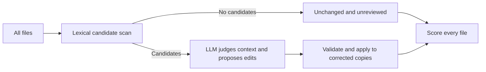

# Whole-set correction evaluation of the 0.3 candidate

**The tested 0.3 workflow did not meet the accuracy-first efficiency goal.** It saved
calls and input tokens, but did not preserve correction quality. Exact candidate delivery
and a review skill remain useful infrastructure; they are not proof of better correction.

All conditions used the same full files, editorial guidance and output schema. Direct
review called the model for every file. Both gates skipped nine of 32 files, made no model
request for them, and left them unchanged. Every file stayed in every denominator.
Called models could dismiss cues and discover other issues. No encoder was used.

## Actual time and tokens

Each phase allowed four concurrent requests. Wall time includes scanning, requests,
validation and corrected-copy writes. These are initial measured phases; input totals
already include cached input. Output totals retain provider-reported reasoning accounting.

| Model / workflow | Calls / skips | Input tokens | Output tokens | Wall seconds |
|---|---:|---:|---:|---:|
| Luna / direct + skill | 32 / 0 | 513,972 | 23,463 | 97.80 |
| Luna / 0.2 gate + skill | 23 / 9 | 378,238 | 19,864 | 83.67 |
| Luna / 0.3 gate + skill | 23 / 9 | 382,553 | 19,134 | 73.60 |
| Haiku / direct + skill | 32 / 0 | 583,331 | 161,816 | 204.95 |
| Haiku / 0.2 gate + skill | 23 / 9 | 414,645 | 178,802 | 214.90 |
| Haiku / 0.3 gate + skill | 23 / 9 | 449,846 | 197,247 | 238.99 |

One Luna direct response duplicated its document row and was rejected. A single
identical-input/prompt repair preserved the failed attempt and raised completed direct
cost to 33 requests, 529,841 input and 24,454 output tokens. Initial wall 97.80s plus the
separate 16.16s repair interval is 113.96s composite active time, not a new continuous phase.
The quality counts below did not change after repair.

Against initial direct, 0.3 reduced Luna input by 25.6%, output by 18.5% and wall time by
24.7%. With Haiku it reduced input by 22.9%, but increased output by 21.9% and wall time by
16.6%. Fewer calls did not guarantee less reasoning or faster completion. Native 0.3 scanning
itself took about 0.42–0.44 seconds across all 32 per-file invocations.

## Actual correction quality

Independent native-model reviewers read all distinct corrected documents and changes with
condition/provider identities hidden. All 86 distinct changed copies and 89 occurrences,
including repair, were covered. These are model judgments, not human annotations.

| Model / workflow | Confirmed original issues resolved / 10 | Files with an unnecessary or damaging change / 32 | Files with grammar regression / 32 |
|---|---:|---:|---:|
| Luna / direct + skill | 2 | 9 | 4 |
| Luna / 0.2 gate + skill | 2 | 5 | 0 |
| Luna / 0.3 gate + skill | 1 | 11 | 7 |
| Haiku / direct + skill | 3 | 3 | 2 |
| Haiku / 0.2 gate + skill | 3 | 4 | 2 |
| Haiku / 0.3 gate + skill | 4 | 9 | 0 |

Uncertain outcomes count as unresolved. Meaning changes are not automatically errors:
justified dehype intentionally weakens claims, and some factual corrections were supported.
The unnecessary/damaging field is separate from literal-meaning preservation and includes
optional or unwanted changes; it is not a count of proven factual mistakes. Real grammar
failures included new fragments and doubled wording.

The limited promising result was Luna with 0.2: the same two confirmed resolutions as direct,
fewer identified bad changes, no observed grammar regressions, and lower cost/time. That is
not evidence of a reliable general gate. Both versions skipped a file with a known issue;
a separate exposed calibration audit skipped 14 of 55 known-positive files.

## What is ready

The native 0.3 candidate adds `tics review`, source-exact JSON/JSONL, a hotspot overview,
embedded CI instructions, a portable skill and one corpus-supported guided-tour cue.
Legacy JSON/compact/score contracts stay stable. This test produced 123 cues in 0.2 and
128 in 0.3; the extra five did not change the called-file set. No new edit-probability claim
was fitted from AI-origin labels. Nothing was merged or published.

The byte contract is checked separately: full source replay, Unicode/BOM and CRLF, masked
code annotation, deduplicated paths, zero-call skips and unchanged source copies. Production
hardening leaves the 32 comparison candidate payloads and gate decisions unchanged.

## Limits and verdict

The set contains 14,681 words: 12 RAID abstracts, 16 Cosmopedia documents and four technical
files. Selection used metadata and length, not cues, but was not population-random. Its
315 blocks contained ten positive category judgments (E1/I7/C0/S2), 781 acceptable and
469 uncertain cells. Three technical files were raw TXT/RST, not rendered documentation.
Rare categories and arbitrary genres are not covered by this result.

Every file used a fresh CLI invocation and evaluation labels, cue dispositions and edits
were requested. This is a matched instrumented experiment, not an optimized batched LLM
production baseline. Only one run per condition was measured; cache state and execution
order limit timing claims. Luna requested `gpt-6-luna` without exposing a hosted snapshot;
Haiku returned `claude-haiku-5-5`. Token counts are not billed prices.

The result supports an auditable candidate handoff, but **does not justify promoting 0.3 as
an accuracy-preserving automatic correction upgrade**. Stricter minimal-edit and
claim-strength validation need a new frozen comparison before a stronger claim.
